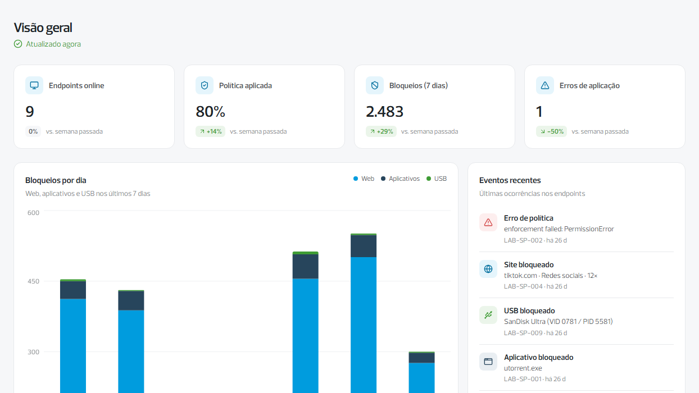
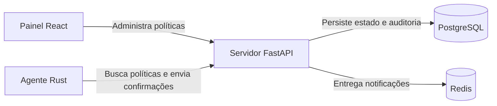

# OpenEMS

**Servidor e agente de código aberto para gerenciar endpoints e aplicar políticas de rede, aplicativos e USB.**

[](https://github.com/kenzofujimoto/openems-server/actions/workflows/ci.yml)
[](https://github.com/kenzofujimoto/openems-server/actions/workflows/security.yml)
[](LICENSE)

[Começar](#comece-pelo-painel) · [Arquitetura](#arquitetura) · [Estado do projeto](#estado-do-projeto) · [Documentação](docs/README.md) · [Contribuir](CONTRIBUTING.md)



*Visão geral do painel em modo de demonstração, com dados fictícios.*

## O que o OpenEMS faz

- **Administração centralizada.** Cadastro e inventário de endpoints, atribuição por grupo, publicação de políticas, confirmação de aplicação pelo agente e auditoria.
- **Controles no Windows.** Agente em Rust distribuído como MSI. Aplica filtro DNS, exibe páginas de bloqueio, e controla aplicativos e armazenamento USB.
- **Política web.** Regras por domínio, categoria e horário, exceções, SafeSearch e modos Permitir, Bloquear e Monitorar. Os eventos DNS registram domínios observados.

## Comece pelo painel

### Demonstração local

Com Node.js 24 e npm, rode o painel com a API simulada. Abra o endereço exibido pelo Vite em `/panel/`. Na tela de login, use `labadmin` e `mock-demo-password`.

```bash
cd web
npm ci
npm run dev:mock
```

### Laboratório com Docker

Na raiz do clone, com Docker Compose e PowerShell disponíveis, gere as credenciais do laboratório e inicie servidor, PostgreSQL e Redis.

```powershell
powershell -NoProfile -ExecutionPolicy Bypass -File .\deploy\new-env.ps1
docker compose up -d --build
docker compose ps
```

Abra [localhost:8013/panel/](http://localhost:8013/panel/) e use o administrador gerado pelo script. Guarde a saída em local seguro e mantenha o `.env` fora do Git. Para parar o laboratório, use `docker compose stop`.

## Arquitetura



| Diretório | Responsabilidade |
| --- | --- |
| `app/` | API de gerenciamento e canal dos endpoints |
| `agent-rs/` | Agente nativo e integração com o sistema operacional |
| `web/` | Painel React servido em `/panel/` |
| `deploy/` | Instaladores, pacotes e roteiros de homologação |
| `agent/` | Implementação Python de referência |

## Estado do projeto

| Plataforma ou integração | Situação |
| --- | --- |
| Windows | Candidato em homologação. A matriz registra o resultado por cenário e por versão do MSI. |
| Linux | Agente e empacotamento disponíveis para avaliação. Aceite operacional em VM pendente. |
| macOS | Implementação parcial. Network Extension e Endpoint Security em aberto. |
| Extensão de navegador | Integração opcional com o agente em desenvolvimento. Depende do broker nativo. |

Veja a [matriz de aceite](ACCEPTANCE.md), o [roadmap desktop](roadmap-v2.md) e o [PR de homologação Windows](https://github.com/kenzofujimoto/openems-server/pull/13) para acompanhar evidências, pendências e o alcance de cada teste.

## Documentação e contribuição

- [Índice por tarefa](docs/README.md) para guias de desenvolvimento, homologação e operação.
- [Como contribuir](CONTRIBUTING.md) e [como reportar uma vulnerabilidade](SECURITY.md).
- [Especificação de interoperabilidade](SPEC-INTEROP.md) para os endpoints, fluxos e limites da compatibilidade.

O OpenEMS é um projeto clean-room independente, sem afiliação com a Fortinet. A compatibilidade se baseia na interface documentada na especificação. Distribuído sob a [licença MIT](LICENSE).
