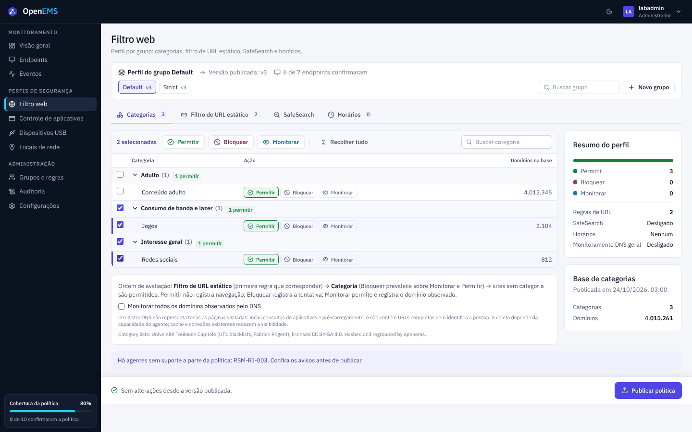
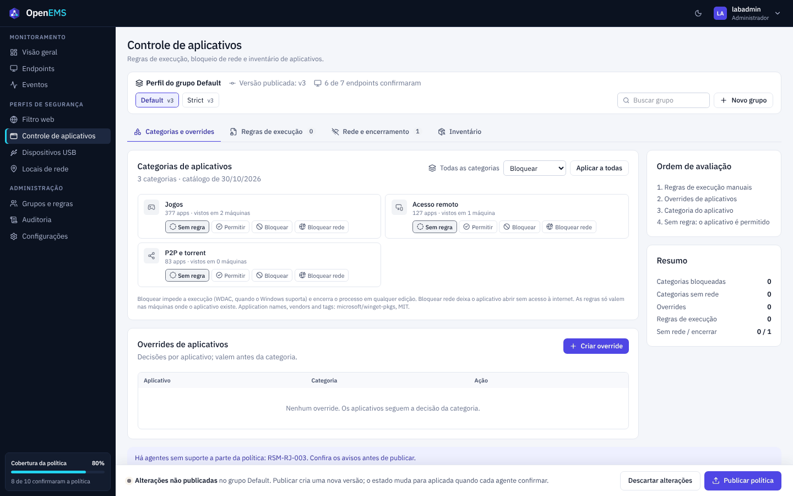
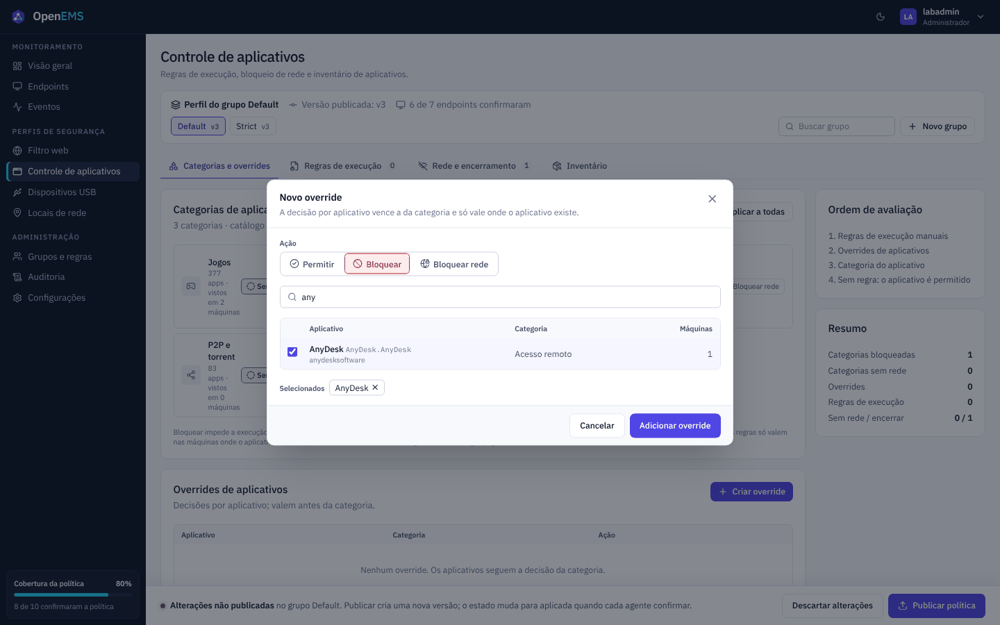
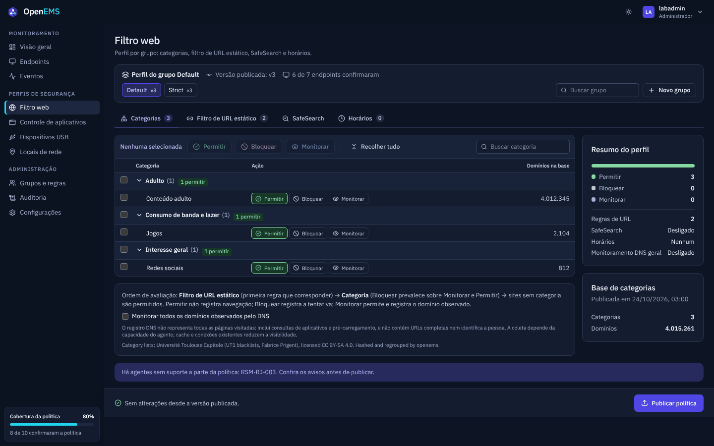
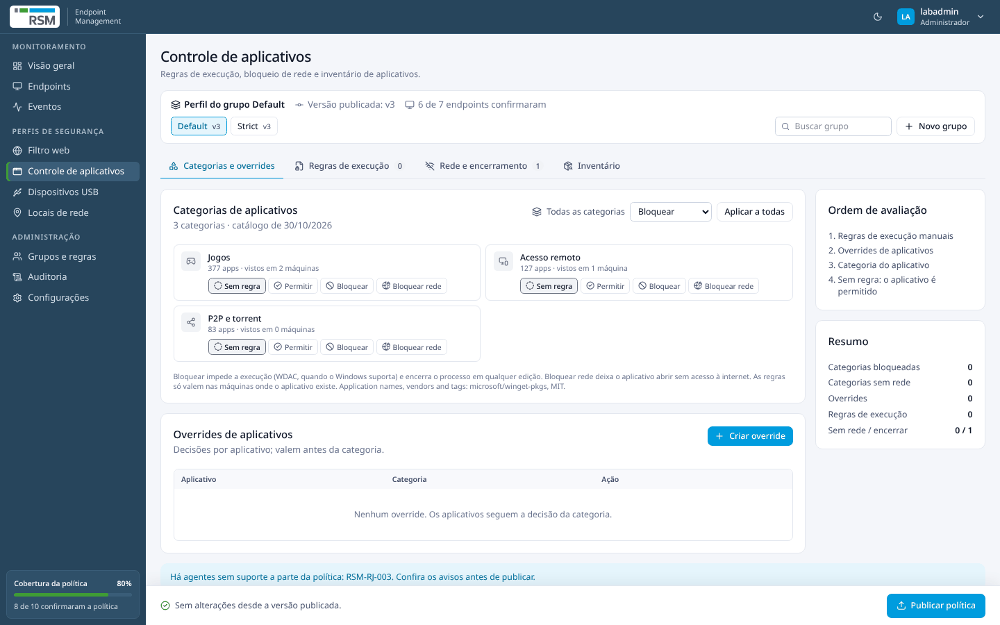

# Redesign dos perfis de segurança e nova identidade visual

Aprovada e implementada em 02/11/2026 (etapas 1 a 4 e fase 2). As imagens "novo-*" são os mockups da proposta; as "impl-*", na seção 6, são o painel implementado. O aceite em Windows real da ação Avisar continua pendente.

Objetivo: deixar as telas de **Filtro web** e **Controle de aplicativos** com os padrões de operação do FortiGate e do FortiClient EMS (categorias agrupadas, ação em lote, overrides priorizados, aplicar/cancelar) e trocar a identidade RSM por uma identidade própria do OpenEMS.

## 1. Como o painel está hoje

**Arquitetura.** `web/` é React 19 + TanStack Router/Query + Tailwind 4 + Radix + zod, com mocks MSW (`npm run dev:mock`). O FastAPI serve o painel em `/panel/`. Cada grupo (`vdom`) tem **um perfil** com as seções `web_filter`, `app_control`, `app_catalog` e `usb_control`. `PolicyWorkspace` escolhe o grupo e `PolicyForm` publica o corpo inteiro com `digest` (concorrência otimista, 409/412). Essa base fica como está: a proposta muda só a apresentação.

**Acoplamento com a RSM.**

| Onde | O quê |
|---|---|
| `web/src/styles.css` | tokens `--color-rsm-*` e fonte Prelo/Noto Sans; usados em cerca de 12 componentes (`bg-rsm-blue`, `text-rsm-green`…) |
| `Sidebar.tsx`, `LoginPage.tsx`, `index.html` | `brand/rsm-logo.png`, favicon e título "RSM Endpoint Management" |
| `mocks/data.ts`, testes | endpoints `RSM-SP-001`… (só dados de exemplo) |

**Problemas de uso encontrados.**

| Tela | Problema |
|---|---|
| Todas as políticas | O seletor de grupo é um card repetido em cada página. A página é uma coluna longa de cards, com o botão Publicar no fim e sem indicação de alterações pendentes. |
| Filtro web | Cada categoria é um card com três botões (27 categorias = 81 botões). Não há ação em lote, busca, recolher por grupo nem total por ação. Os horários repetem todas as categorias dentro de cada janela. |
| Aplicativos | As decisões por aplicativo (`app:<id>`) **só aparecem quando você busca o app**: não há lista das exceções vigentes. Regras de execução, lista de rede e lista de encerramento são textareas e formulários soltos. O inventário fica no meio da página. |

| Atual · Filtro web | Atual · Aplicativos |
|---|---|
|  |  |

## 2. Referências

O acesso a `docs.fortinet.com` estava bloqueado na rede desta sessão. Por isso as imagens abaixo são **esquemas recriados a partir da documentação pública**, e não capturas de tela. Elas não usam marcas nem ícones originais e servem só para comparar padrões. Documentação oficial:

- FortiGate, filtro web por categoria FortiGuard: <https://docs.fortinet.com/document/fortigate/7.4.1/administration-guide/675558>
- FortiGate, filtros de categoria e overrides do Application Control: <https://docs.fortinet.com/document/fortigate/6.2.0/cookbook/19814>
- FortiClient EMS, perfil de Web Filter: <https://docs.fortinet.com/document/forticlient/7.0.1/ems-administration-guide/68075>

O que vale copiar: (1) perfil como objeto editável, com cabeçalho e versão; (2) categorias numa tabela densa, agrupada e recolhível, com contagem; (3) toolbar de ação que vale para várias linhas selecionadas; (4) seletor de ação no cabeçalho do grupo e opção "todas as categorias"; (5) lista de exceções (URL estático / overrides) avaliada **antes** das categorias; (6) confirmar/cancelar explícito.

O que **não** copiar: cores, ícones, nomes de produto e o layout pixel a pixel da Fortinet. O README do projeto já evita a marca Fortinet, e a proposta segue essa regra: copia padrões de interação, com identidade própria.

## 3. Proposta

### Shell

- Barra superior escura com logo, breadcrumb, busca global (Ctrl K), **seletor de grupo global** (substitui o card repetido) e o usuário.
- Navegação lateral escura: Monitoramento / Perfis de segurança / Administração.
- Barra fixa de publicação: "N alterações não publicadas", Ver diferenças, Descartar e Publicar vN.
- Cada perfil é dividido em abas, sem a coluna longa de cards.

### Filtro web

- Abas: **Categorias** · Filtro de URL estático (atual `DomainRulesTable`) · SafeSearch · Horários · Opções.
- Tabela agrupada, com checkbox no grupo (inclusive estado misto), toolbar Permitir / Monitorar / Bloquear para a seleção, busca e "Expandir tudo".
- Cada linha mostra a ação (pill com menu), os domínios na base, os bloqueios em 7 dias (de `/api/v1/stats` ou dos eventos) e quantas regras de URL tocam a categoria.
- O cabeçalho do grupo mostra a distribuição das ações.
- "Não classificado" aparece fixo em Permitir (é o comportamento atual). "Avisar" fica desabilitado até existir suporte no agente.
- Painel lateral com o resumo por ação, `monitor_all`, a saúde da base de categorias e os agentes sem a capability.

### Controle de aplicativos

- Abas: **Categorias e overrides** · Regras de execução (WDAC) · Rede e encerramento · Inventário · Opções.
- Grade com as 14 categorias do catálogo. Cada uma tem ícone, total de apps, máquinas onde foi vista e um menu de ação (Sem regra / Permitir / Bloquear / Bloquear rede). "Todas as categorias" aplica a ação em lote.
- **Overrides de aplicativos e filtros**: uma tabela única com todas as decisões `app:<id>` e as `execution_rules` manuais, com tipo, ação, máquinas afetadas e comentário. Isso resolve a falta de lista das exceções vigentes.

- O diálogo "Novo override" tem tipo (Aplicativo / Filtro / Hash-editor-caminho), ação, busca no catálogo com seleção múltipla e o filtro "só vistos no parque". Apps da Microsoft aparecem como não bloqueáveis. Há um comentário que vai para a auditoria e um aviso do impacto antes de confirmar.

### Mapeamento para o modelo atual

| Elemento da UI | Contrato | Muda o backend? |
|---|---|---|
| Ação em lote, grupos, busca, resumo | `web_filter.category_actions` | Não |
| Bloqueios 7 dias por categoria | eventos `web_block` agregados | Talvez uma rota agregada |
| Categoria de app / "Todas" | `app_catalog.actions["category:<id>"]` | Não |
| Override por app (um ou vários) | `app_catalog.actions["app:<id>"]`, que já vence a categoria em `app/app_catalog.py` | Não |
| Override por hash/editor/caminho | `app_control.execution_rules` | Não |
| Ordem ↑↓ dos overrides | precedência fixa aplicativo > editor > categoria | Substituída por regra fixa |
| Override por **filtro** de editor | `app_catalog.actions["vendor:<nome>"]` | Implementado (fase 2) |
| Comentário do override | `app_catalog.notes` | Implementado (fase 2) |
| Avisar no filtro web | `warn` + capacidade `web-filter:warn` | Implementado (fase 2); Autenticar não |

## 4. Nova identidade visual

- **Marca:** hexágono (perímetro) com três nós (endpoints). O nó em ciano é o agente que confirma a política. Funciona a partir de 16 px e substitui `rsm-logo.png`.
- **Cores:** Noite `#0B1220` (shell), Índigo `#4F46E5` (ação primária e seleção), Sinal `#22D3EE` (acento). As cores de ação são semânticas e fixas: Permitir verde, Monitorar azul, Bloquear vermelho, Bloquear rede laranja, Avisar âmbar, Sem regra cinza. A cor da marca nunca representa uma ação.
- **Tipografia:** IBM Plex Sans + IBM Plex Mono (OFL, via `@fontsource`), no lugar de Prelo/Noto.
- **Tokens:** renomear `--color-rsm-*` para tokens semânticos (`--color-brand`, `--color-action-allow`…), com o tema escuro redefinido nos mesmos nomes.
- **Nome:** "OpenEMS" é também o nome de um projeto open source conhecido de gestão de energia (openems.io). Recomendo checar marca e domínio antes de fixar o logotipo. A identidade funciona com outro nome sem mudar o símbolo.

### Edição RSM mantida em paralelo

A identidade RSM continua disponível no mesmo código, escolhida no build. Layout, telas e cores de ação são os mesmos nas duas edições; só mudam logo, título, favicon, fonte e cores da marca (`html[data-brand="rsm"]` em `web/src/styles.css`).

| Edição | Desenvolvimento (mock) | Build | Docker |
|---|---|---|---|
| OpenEMS (padrão) | `npm run dev:mock` | `npm run build` | `docker build .` |
| RSM Brasil | `npm run dev:mock:rsm` | `npm run build:rsm` | `docker build --build-arg PANEL_BRAND=rsm .` |

O agente segue a mesma escolha (texto da bandeja, página de bloqueio e aviso, descrição do serviço e fabricante do MSI):

| Edição | Agente nativo | MSI | Agente Python de referência |
|---|---|---|---|
| OpenEMS (padrão) | `cargo build --release` | `wix build … ` | padrão |
| RSM Brasil | `cargo build --release --features rsm-brand` | `wix build … -d Edition=rsm` | `OPENEMS_BRAND=rsm` |

Na edição RSM os textos são os mesmos de antes ("RSM Endpoint: proteção ativa", rodapé "RSM Brasil · O poder de ser compreendido").

## 5. Plano de implementação e estado

1. ✅ **Identidade:** tokens semânticos em `styles.css`, troca de `rsm-*` nos componentes, logo SVG, favicon, título, fontes Plex. Os testes não dependem de cor; só os mocks `RSM-*` podem ser renomeados.
2. ✅ **Shell:** barra superior e navegação escuras; barra do grupo compacta no topo de cada perfil (o grupo escolhido continua valendo entre as páginas, via `storedGroup`); abas que preservam as edições; barra fixa com "Alterações não publicadas", Descartar e Publicar. Diferença em relação ao mockup: o seletor de grupo fica no cabeçalho do perfil, não na barra superior, e as alterações aparecem em "Ver diferenças" (fase 2).
3. ✅ **Filtro web:** `CategoryTable` com grupos recolhíveis, seleção (inclusive de grupo, com estado misto), ações em lote, busca e resumo lateral; os horários usam a mesma tabela. A coluna "Bloqueios (7 dias)" do mockup ficou fora: exige agregação no servidor e passa por dados pessoais de navegação.
4. ✅ **Aplicativos:** `AppCategoryGrid` (com "Todas as categorias"), `AppOverrides` (lista das decisões `app:*`) e diálogo "Novo override" com busca e seleção múltipla. Regras de execução, rede/encerramento e inventário ficam em abas próprias; o inventário continua utilizável por leitores. As regras de execução manuais ficam na aba delas, não na tabela de overrides, porque sempre se somam às decisões do catálogo.
5. ✅ **Fase 2:**
   - "Ver diferenças" na barra de publicação (comparação com a versão publicada, inclusive mudança só de ordem).
   - Override por **editor** (`vendor:<nome>`) e **comentários** (`app_catalog.notes`) no servidor e no painel. Precedência fixa: aplicativo > editor > categoria; por isso a tabela não tem ↑↓ (não há empate a ordenar). Editores Microsoft só aceitam Permitir.
   - Ação **Avisar** (`warn`) em categorias, horários e regras de domínio, com página de aviso e "Continuar mesmo assim" no agente nativo (ver o [contrato](../web-filter-actions-contract.md#warning-warn)). Exige a capacidade `web-filter:warn`; aceite em Windows real ainda pendente.
   - Fica de fora, por decisão: a coluna "Bloqueios (7 dias)" por categoria, que exigiria expor no editor de política dados pessoais de navegação.

Cada etapa mantém o contrato de política, e os testes atuais de `web/src/features/**` continuam valendo. As interações novas (seleção em lote, estado misto, diálogo de override) ganham testes próprios.

## 6. Painel implementado

| Filtro web | Controle de aplicativos |
|---|---|
|  |  |
|  |  |

Edição RSM (`npm run build:rsm`), com as mesmas telas:

