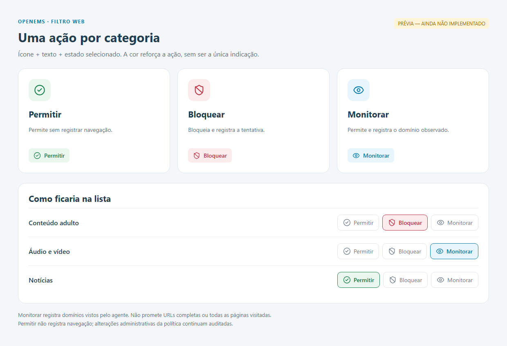

# Plano: Permitir, Bloquear e Monitorar

Estado em 27/10/2026: **proposta para aprovação; não implementada**. A documentação foi solicitada para publicação na main. A mudança de política/agente/API/painel depende da aprovação deste plano, conforme o fluxo spec-driven do usuário.

## Controles propostos

| Ação | Ícone Lucide | Comportamento proposto |
|---|---|---|
| Permitir | `CircleCheck`, verde | Permite; não gera log de navegação para essa decisão |
| Bloquear | `ShieldBan`, vermelho | Bloqueia e registra a tentativa observada |
| Monitorar | `Eye`, azul | Permite e registra os domínios observados pela instrumentação disponível |

Os controles devem ter texto, nome acessível, foco de teclado e estado selecionado perceptível sem depender apenas da cor. O olho significa monitoramento de domínios; não será apresentado como histórico completo de URLs.

Prévia visual dos componentes propostos, sem alteração da aplicação atual:

Não confundir ausência de log de navegação com ausência de auditoria: publicar/alterar políticas continua sendo uma ação administrativa auditada.

## Semântica recomendada

1. Exceção explícita de domínio prevalece sobre ações das categorias e horários. Uma exceção Permitir também suprime o log de navegação dessa decisão.
2. Quando o domínio pertence a várias categorias, Bloquear prevalece sobre Monitorar, e Monitorar sobre Permitir. Permitir uma categoria não deve liberar silenciosamente um site também classificado numa categoria bloqueada; usar a exceção por domínio para isso.
3. Categoria ausente na política equivale a Permitir, preservando o comportamento atual. Domínio desconhecido/não classificado é um estado distinto de lista ausente ou desatualizada.
4. Bloqueios de antiburla/DoH e controles de aplicativo permanecem independentes. A exceção web não deve desativar esses controles.
5. Políticas antigas com `blocked_categories` conservam significado. Um campo novo de ações exigirá migração/normalização, rejeição de conflitos e capacidade explícita do agente; agente antigo não pode confirmar sucesso ignorando Monitorar. O download/cache deve incluir categorias monitoradas, não apenas bloqueadas.
6. Eventos devem distinguir `blocked` de `monitored`, motivo, categoria e origem da observação. Totais de bloqueios não podem incluir monitoramento. Não chamar consultas de visitas nem contagens de pessoas.

Monitorar uma categoria registra somente as observações que correspondem a ela. Para observar também outros domínios, inclusive não classificados, é necessária uma opção global explícita e distinta, com o mesmo aviso de cobertura DNS. Essa coleta ampla não será ativada automaticamente ao trocar um checkbox por Monitorar.

## Como reduzir as lacunas

| Lacuna | Mitigação proposta | Limite que permanece |
|---|---|---|
| Categorias Business/Entertainment e outras ausentes | Inventariar listas disponíveis/licenciadas, criar taxonomia versionada, fontes documentadas e corpus de validação por categoria | Adicionar rótulo sem base verificável não cria cobertura |
| Site novo ou mal classificado | Exceções locais com motivo, auditoria, revisão e eventual recategorização local por grupo | Não equivale a reputação comercial em tempo real |
| Domínios não classificados | Ação configurável separada e indicador de cobertura; evitar bloqueio global por padrão | Um domínio legítimo também pode ser desconhecido |
| Lista indisponível/desatualizada | Mostrar idade, fonte, último sucesso, digest e erro; preservar cache válido e tornar degradação visível | Decisão sem base disponível não pode ser vendida como classificação confiável |
| Registro de acessos permitidos | Instrumentar consultas DNS nos agentes capazes; deduplicar, agregar, limitar filas e indicar origem | Cache, conexões existentes, pré-carregamento e DNS não observado limitam a cobertura |
| URLs e navegação no navegador | Segunda etapa opcional com extensão gerenciada Chrome/Firefox e comunicação autenticada com agente | Exige permissões/distribuição próprias; não cobre outros aplicativos; sem chave genérica de interceptação HTTPS |
| Identificação por pessoa | Se necessária, especificar vínculo de sessão e acesso aos dados separadamente | O registro atual identifica máquina, não a pessoa responsável pela navegação |
| Exceção de serviços como Netflix | Lista de dependências testada, por serviço/grupo, com revisão periódica e teste real de reprodução | Domínios/CDNs mudam e podem ser compartilhados |

Extensão de navegador é um caminho futuro de maior visibilidade, não dependência escondida da primeira entrega DNS. A implementação deve declarar capacidades por plataforma e recusar configurações não suportadas. Não habilitar coleta ampla por padrão.

## Ordem de implementação após aprovação

1. **Contratos e TDD:** vetores Python/Rust para três ações, conflitos, sobreposição, exceções, horários, políticas antigas e agentes incompatíveis. Commit dos testes vermelhos antes da implementação.
2. **Núcleo de política:** decisão única com ação, motivo e decisão de registrar. Preservar consistência entre resolver, bloqueio HTTP/HTTPS e referência Python.
3. **Telemetria e persistência:** contrato versionado para eventos monitorados, migração PostgreSQL, stores e agregadores limitados; envio autenticado/retry sem inflar contagem. Manter filtros de autorização, retenção e auditoria de leitura.
4. **Painel:** substituir checkbox por seletor acessível das três ações; defaults claros, avisos de capacidade e filtros separados de bloqueio/monitoramento.
5. **Aceite:** DNS real no Sandbox/VM, permitido sem evento, monitorado com evento e sem bloqueio, bloqueado com evento, exceção sem evento, múltiplas categorias, cache/offline, fila saturada, atualização e remoção. Depois homologação Chrome/Firefox no Windows real.
6. **Ampliação de cobertura:** categorias extras somente após validar fonte/licença e corpus; extensão em etapa própria com especificação e aceite próprios.

Executar as suítes Python/Rust/painel e os contratos PostgreSQL pertinentes; lint/tipos/build. Publicar unidades concluídas na main conforme autorização do usuário, mantendo pendências e sem anunciar a funcionalidade antes do aceite.

## Riscos e limites

- Volume maior de dados: filas limitadas, descarte contabilizado, filtros e retenção configurável. Proposta inicial preserva agregação por hora e retenção atual de 30 dias, sem usuário do Windows, URLs completas ou parâmetros.
- Domínios associados a endpoint podem revelar hábitos e dados sensíveis. Coleta deve ser explícita, com finalidade comunicada, acesso restrito e auditoria; validação operacional/LGPD continua necessária antes da produção.
- Não alterar CA, DNS ou agente do host de desenvolvimento para validar esta proposta. Aceites de enforcement pertencem ao ambiente descartável/homologação autorizado.
- Ícones e prévia são proposta visual. A main atual ainda contém checkboxes e somente eventos de bloqueio web.
